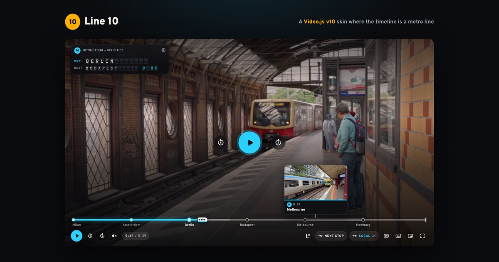

# Line 10

**A Video.js v10 skin where the timeline is a metro line.** Chapters are stations, the playhead is a train, the title flips onto a split-flap departure board, and playback speed is the service you ride.

**[Live demo](https://me.aleex.workers.dev/line10/)** · [Used on a real page](https://me.aleex.workers.dev/case/line10-reel/)



## What it does

- **Stations are chapters.** The seek bar is a metro line with a stop for each chapter. Hover the line for a station sign with a preview frame.
- **The train is the playhead.** Drag it, click the line, or use the arrow keys.
- **Departure board.** NOW and NEXT stations, and the time to the next stop, on split-flap tiles.
- **Service is speed.** Slow, Night, Local, Limited, Express and Rapid.
- **Held at a signal.** While the video buffers, a small train waits between two stops.
- **Terminus.** At the end, a card offers "Ride again" and, if the page provides one, a change to the next line.
- **Settings that stick.** Board size, position and style, caption size, colour, background, outline, shadow and brackets, volume, speed and quality are remembered.
- **Quality menu** with Auto and every rendition of the stream.
- **Picture-in-picture with the whole player** where the browser supports Document Picture-in-Picture, and the browser's own PiP with captions elsewhere.
- **Small players.** Below about 770px the bar keeps the essentials and a Settings menu holds the rest. No control leaves the player from 250px wide.
- **Phones.** Below 540px the line and the buttons move into a strip under the picture, so nothing covers the video and every button stays 44px. Fullscreen goes back to the overlay.
- **Taps.** Click the picture to play or pause and double-click for fullscreen. On touch, double-tap the left or right third to skip 5 seconds. On phones a tap plays or pauses, and dragging the train gives a small buzz at each station where the phone supports it.
- **Share a stop.** The link button on the departure board (or U) shares the station you're at: phones open their share sheet, desktops copy the link, and if a browser blocks copying the link is shown ready to copy.
- **Time links.** A link ending in `?t=25` opens the player at 0:25 with a Start over (R) note; a plain link starts at the beginning.
- **Nothing stored.** Every visit starts from the same defaults (Auto quality, 40% volume on desktop, phone volume on phones); choices carry over between videos during a visit only.
- **Time display.** Click the time (or T) to switch between the total length and the time left. 
- **Phones.** No volume control on phones and tablets: the phone's own buttons set the volume. Skips show arrows on the side you skip to.
- **Ambient light.** A soft glow taken from the picture itself lights the page around the player, and the poster fades into the first frame.
- **Any line colour** with one attribute.

## Use it

```html
<link rel="stylesheet" href="release/fonts/fonts.css">
<link rel="stylesheet" href="release/line10.css">
<script type="module" src="release/line10-player.js"></script>

<line10-player
  playback-id="YOUR_MUX_PLAYBACK_ID"
  title="My video"
  chapters="chapters.vtt"
  captions="captions.en.vtt"
  number="10"
  line="#ffb000"></line10-player>
```

The `release/` folder holds the built files. Keep the files in it together, because the player loads the Mux engine from the same folder when it needs it.

### Attributes

| Attribute | What it does |
|---|---|
| `playback-id` | A Mux playback ID. Streams with every rendition and uses Mux's storyboard for the preview frames. |
| `src` | Any video file or stream URL, used when there is no `playback-id`. |
| `title` | Shown on the departure board. |
| `chapters` | A WebVTT chapters file. Each cue becomes a station. Without it, the line is a plain track. |
| `captions` | A WebVTT captions file. Text in `[square brackets]` is drawn with the viewer's bracket style. |
| `poster` | Poster image. |
| `storyboard` | A WebVTT thumbnail track for preview frames (not needed with `playback-id`). |
| `number` | The line's badge, for example `10` or `N`. |
| `line` | The line colour. Can be changed at any time. |
| `ratio` | Aspect ratio, for example `9 / 16`. The default is 16:9. |
| `next-title`, `next-number`, `next-line` | Offer a "Change here for…" button at the end. |
| `autoplay` | Start playing as soon as the video is ready. |
| `ambient` | Set to `off` to turn off the soft glow of the picture around the player. |
| `start` | Start at this many seconds. A `?t=25` (or `?sec=25`) in the page address does the same for the first player, like a YouTube link. |

When the viewer picks "Change here", the player fires a `line10:next` event. What happens next is up to the page:

```js
player.addEventListener('line10:next', () => { /* load the next video */ });
```

### Theming

- `line` sets the accent colour.
- `--media-accent-text-color` sets the text colour used on top of the accent.
- `--media-border-radius` sets the corner radius.
- `--media-font-family` replaces the typeface.

## Keyboard

| Keys | Action |
|---|---|
| Space, K | Play or pause |
| ←, J and →, L | Skip 5 seconds |
| [ and ] | Previous and next station |
| ↑ and ↓ | Volume |
| M | Mute |
| < and > | Slower and faster |
| C | Captions |
| F | Fullscreen |
| I | Picture-in-picture |
| 0–9, Home, End | Jump through the video |
| S | Settings (small players) |
| N, R | At the end of the line: change to the next line, or ride again |
| R | After opening a time link: start over |
| T | Switch the time between total and time left |
| B | Departure board settings |
| A | All stations |
| Q | Quality |
| Shift + C | Caption style |
| U | Share this stop (again: close the note) |
| Esc | Close any menu in one press, or the note on the picture; leaves fullscreen |

Every control has a label and a tooltip with its keys, menus work with the arrow keys and close with Esc, and the current station is announced to screen readers. Reduced motion turns off the flips and pulses, and forced-colours mode gets solid system surfaces.

## Develop

```sh
npm install
npm run dev        # demo page with hot reload
npm run build      # demo page into dist/
npm run build:lib  # the player into dist-lib/
```

- `src/line10/line10.js` is the `<line10-player>` element, built from Video.js v10 components.
- `src/line10/line10.css` is the skin.
- `src/line10/icons.js` holds the icons.
- `index.html`, `src/main.js` and `src/demo.css` are the demo page.

## Browser support

Tested in Chrome, Edge, Opera and Firefox on desktop, and in Chrome's phone emulation. Safari uses the same code with the browser's own HLS and picture-in-picture, and has had less testing.

## Credits

- Built on [Video.js v10](https://videojs.com) and streamed with [Mux](https://www.mux.com).
- Typeface: Overpass and Overpass Mono (SIL Open Font License).
- Demo footage: Pexels and Mux sample videos.

## Licence

Apache-2.0. Copyright 2026 Alexander Atanasov.
